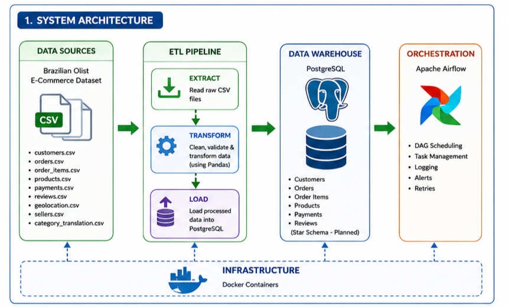
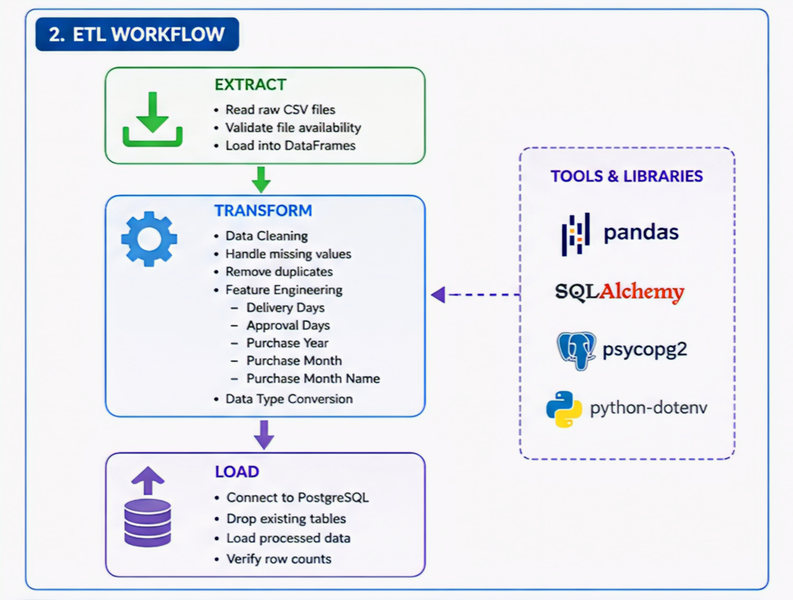
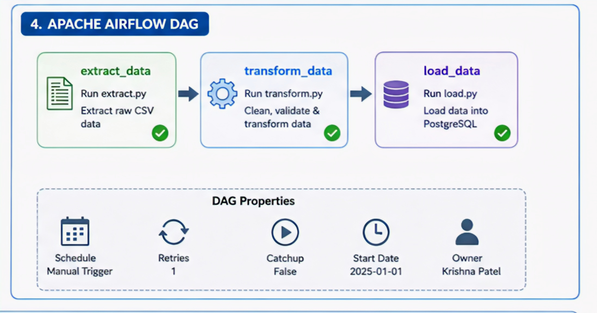
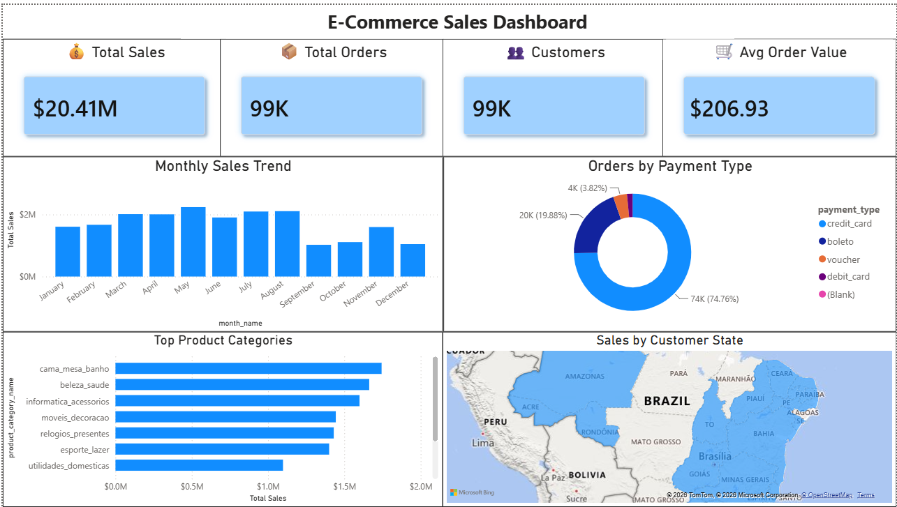
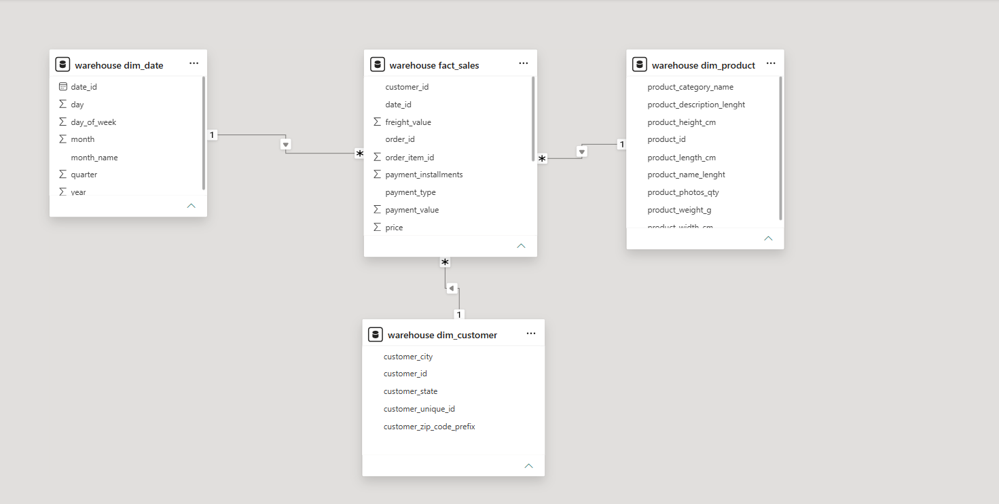
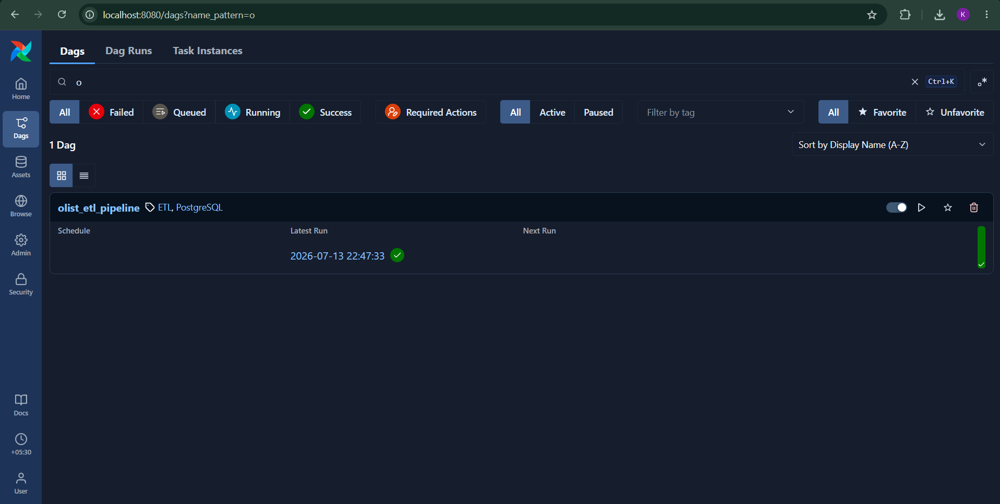
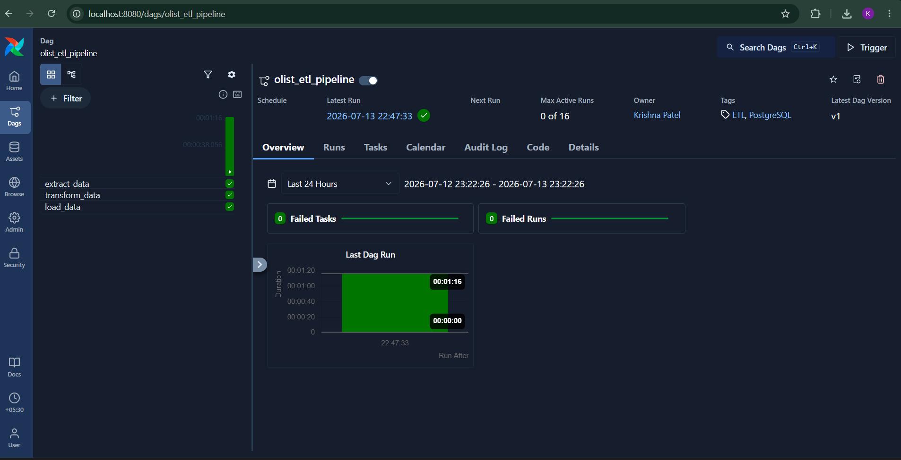

# 📦 E-Commerce Sales Data Engineering Pipeline


An end-to-end **Data Engineering Pipeline** built using the **Brazilian Olist E-Commerce Dataset**.

This project demonstrates the complete lifecycle of a modern data engineering solution—from raw CSV ingestion and ETL processing to PostgreSQL data warehousing, Apache Airflow orchestration, Docker containerization, and interactive business dashboards using Power BI.

---

# ⭐ Key Highlights

- 📦 End-to-End ETL Pipeline
- 🛢️ PostgreSQL Data Warehouse
- ⭐ Star Schema Data Warehouse
- ⚙️ Apache Airflow Workflow Automation
- 🐳 Dockerized Deployment
- 📊 Interactive Power BI Dashboard
- 🧹 Data Cleaning & Feature Engineering

---

# 🚀 Project Overview

The objective of this project is to build a production-style ETL pipeline that processes raw e-commerce data and loads it into a PostgreSQL data warehouse for business intelligence and analytical reporting.

Pipeline Flow:

- Extract raw CSV datasets
- Clean and transform data
- Perform feature engineering
- Build Star Schema dimensions and fact table
- Load into PostgreSQL
- Automate execution using Apache Airflow
- Visualize business insights using Power BI

---

# 🏗️ System Architecture

<p align="center">

</p>

---

# 🛠️ Technology Stack

| Category | Technology |
|-----------|------------|
| Programming Language | Python |
| Data Processing | Pandas |
| Database | PostgreSQL |
| Workflow Orchestration | Apache Airflow |
| Containerization | Docker |
| Dashboard | Power BI |
| ORM | SQLAlchemy |
| Database Driver | psycopg2 |
| Environment Variables | python-dotenv |
| Version Control | Git & GitHub |

---

# 📂 Project Structure

```text
E-COMMERCE_SALES/
│
├── airflow/
│   ├── dags/
│   ├── config/
│   ├── logs/
│   ├── plugins/
│   └── requirements.txt
│
├── data/
│   ├── raw/
│   └── processed/
│
├── docs/
│   └── images/
│
├── etl/
│   ├── extract.py
│   ├── transform.py
│   ├── load.py
│   └── utils.py
│
├── notebooks/
├── powerbi/
│   └── Olist_Sales_Dashboard.pbix
│
├── screenshots/
│   ├── airflow_dashboard.png
│   ├── dag_graph.png
│   ├── powerbi_dashboard.png
│   └── powerbi_model.png
│
├── sql/
│
├── Dockerfile
├── docker-compose.yaml
├── requirements.txt
├── .env
└── README.md
```

---

# 🔄 ETL Workflow

<p align="center">

</p>

### Extract

- Read raw CSV files
- Validate source datasets

### Transform

- Handle missing values
- Remove duplicate records
- Convert timestamp columns
- Perform feature engineering
- Build analytical dimensions

### Load

- Populate Star Schema
- Load data into PostgreSQL
- Verify successful execution

---

# 🛢️ PostgreSQL Data Warehouse

The transformed data is organized into a **Star Schema** for analytical reporting.

Warehouse Tables:

- Fact Sales
- Dim Customer
- Dim Product
- Dim Date

The warehouse is optimized for BI tools and analytical queries.

---

# ⚙️ Apache Airflow Workflow

<p align="center">

</p>

Pipeline Execution

```text
Extract
      ↓
Transform
      ↓
Load
```

Features

- Task Dependencies
- Docker Deployment
- Retry Support
- Logging
- Manual Execution

---

# 📊 Power BI Dashboard

The PostgreSQL warehouse is directly connected to Power BI for business reporting.

Dashboard includes:

- 💰 Total Sales
- 📦 Total Orders
- 👥 Total Customers
- 🛒 Average Order Value
- 📈 Monthly Sales Trend
- 💳 Orders by Payment Type
- 📦 Top Product Categories
- 🌎 Sales by Customer State

## Dashboard Preview

<p align="center">

</p>

## Data Model

<p align="center">

</p>

---

# 📸 Airflow Dashboard

<p align="center">

</p>

---

# 📸 DAG Graph

<p align="center">

</p>

---

# 📊 Dataset

Brazilian Olist Public E-Commerce Dataset

Includes

- Customers
- Orders
- Products
- Payments
- Reviews
- Sellers
- Geolocation

---

# 📈 Project Results

- ✅ End-to-End ETL Pipeline
- ✅ PostgreSQL Star Schema
- ✅ Apache Airflow Automation
- ✅ Dockerized Environment
- ✅ Power BI Dashboard
- ✅ Business Analytics

---

# 🚀 Getting Started

### Clone Repository

```bash
git clone https://github.com/<your-github-username>/E-COMMERCE_SALES.git
```

### Start Services

```bash
docker compose up -d
```

### Open Airflow

```
http://localhost:8080
```

Default Login

```
Username : airflow

Password : airflow
```

---

# 💡 Skills Demonstrated

- Data Engineering
- ETL Development
- Data Warehousing
- Star Schema Modeling
- SQL
- PostgreSQL
- Docker
- Apache Airflow
- Power BI
- Data Visualization
- Git & GitHub

---

# 🔮 Future Improvements

- Incremental Data Loading
- Data Quality Validation
- AWS Deployment
- CI/CD Pipeline
- Snowflake Integration

---

# 👨‍💻 Author

**Krishna Patel**